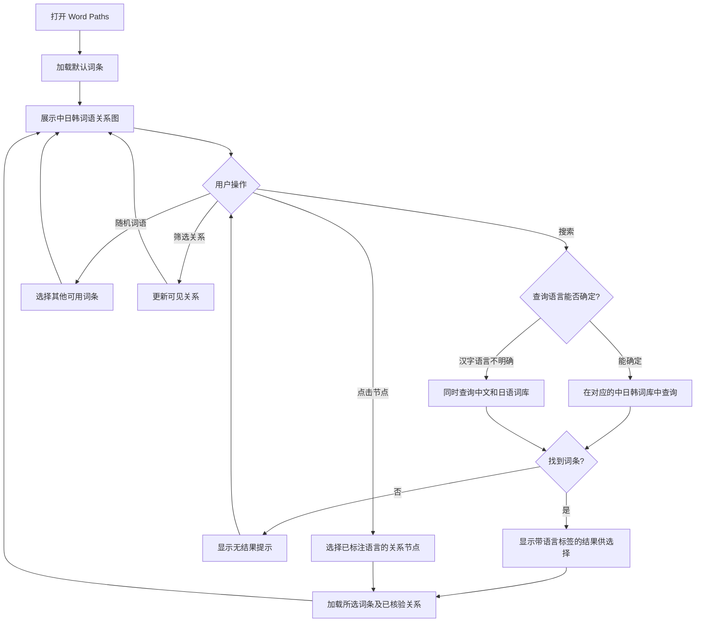
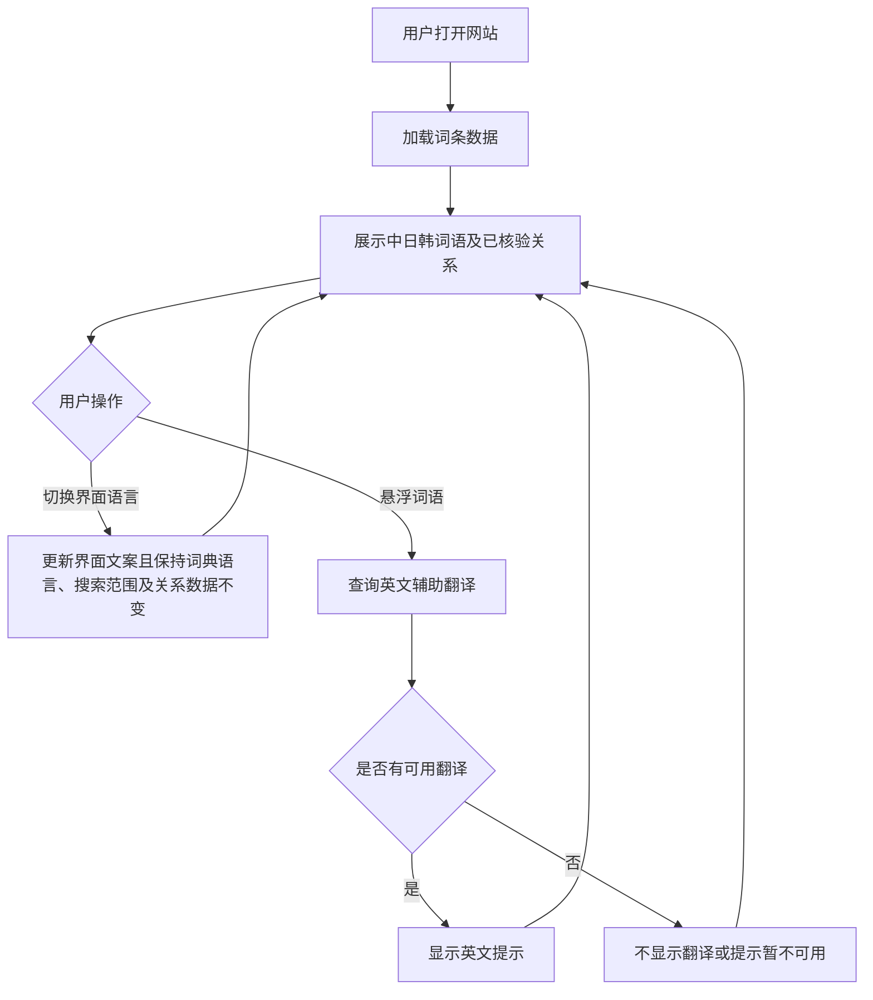

# Word Paths 产品需求文档（PRD）

## 📋 项目信息

| 字段 | 内容 |
|---|---|
| 产品名称 | Word Paths |
| 产品类型 | 中日韩汉字词关系可视化 Web 应用 |
| 项目课程 | SD5913 — Interactive Experience |
| 版本定义 | v0.10 — 关系分类、来源补充与审核状态版 |
| 文档负责人 | 项目本人，独立负责 |
| 当前阶段 | VS Code 项目已建立并可运行，正在完善数据接口与交互 |
| 核心目标 | 通过可视化关系图，帮助用户探索中文、日语和韩语中的汉字词及其语义联系 |
| 主要用户 | 中文母语者，尤其是正在学习日语、韩语或英语的用户 |
| 开发周期 | 3 天，优先完成核心体验 |
| 全局原型 | 待补充 |

## 📝 版本记录

| 日期 | 版本号 | 修改内容 | 修改人 |
|---|---|---|---|
| 2026-10-30 | v0.9 | 明确剩余候选关系的批量采用状态；与逐条人工核验状态分开记录和统计 | 项目负责人 |
| 2026-10-31 | v0.10 | 增加 KRDict 与中文维基词典的后端按需资料查询；来源补充与正式词库、关系审核隔离 | 项目负责人 |
| 2026-10-30 | v0.8 | 区分跨语言对应与语义关系，明确关系方向、审核状态及批量候选校验流程 | 项目负责人 |
| 2026-10-30 | v0.7 | 明确默认界面语言、汉字搜索消歧、关系核验准入及 API 不可用时的本地数据策略 | 项目负责人 |
| 2026-10-30 | v0.6 | 调整用户定位、固定词典语言、明确英文辅助翻译及三天 MVP 范围 | 项目负责人 |
| 待定 | v1.0 | 完成核心功能、数据核对和用户体验测试 | 项目负责人 |

## 📑 目录

1. 需求背景
2. 需求目标
3. 用户与使用场景
4. 需求功能清单
5. 详细方案设计
6. 业务流程图
7. 异常与边界处理
8. 数据追踪与埋点
9. 未来演进规划
10. 附件：数据结构与关系标准

---

# 一、需求背景

## 1.1 现状问题

中文、日语和韩语之间存在丰富的汉字词联系。部分词语在字形或含义上相似，但在不同语言中的读音、具体释义及使用方式可能存在差异。

传统词典主要以单个词条的释义为核心，用户需要主动搜索多个词语，才能建立它们之间的联系。

Word Paths 希望将词语之间的联系直接呈现在一个可交互的关系网络中，让用户从一个熟悉的中文词语出发，发现对应的日语、韩语词汇，并进一步探索近义、反义、词源或容易混淆的词语。

目前项目存在两个现实限制：

- Multilingual Dictionary API 的申请仍在等待审批；MVP 不依赖该 API，也不依赖 ConceptNet 才能完成核心体验。
- 开发周期只有三天，能够获取的词条数量和关系覆盖范围有限，不能以建立完整的多语言词库为目标。

因此，项目优先使用具有明确来源且已核验的本地关系；可用可靠关系不足时，以合理的空状态呈现，不以未核验数据填充关系图。

## 1.2 为什么现在做？

本项目是 SD5913 的互动体验设计作业，重点在于探索交互设计如何帮助用户理解和探索信息。

三天内，项目需要形成一个能够运行、可以交互并且具有清晰设计价值的体验。

与其展示大量未经核验的词条，不如先利用有限的数据构建一个清晰、可理解、可以持续探索的词语关系网络。

## 1.3 产品定位

**Word Paths 是一个面向中文母语者的中日韩汉字词关系可视化探索工具。**

它以词语之间的联系为核心，而不是以单词翻译、语言课程或答题为核心。

产品通过可视化关系图帮助用户：

- 发现中文、日语和韩语之间的相关汉字词。
- 理解相似词语在不同语言中的联系与区别。
- 通过点击关系节点持续探索新的词语。
- 借助英文辅助翻译理解词语含义。

## 1.4 产品设计原则

1. **关系优先：** 词语之间的连接是产品核心，释义是辅助信息。
2. **中文出发：** 主要面向中文母语者，优先展示其容易理解的中文词语。
3. **固定词典范围：** 词典始终围绕中文、日语和韩语，不随界面语言改变。
4. **英文辅助：** 英文翻译帮助理解，不作为主要关系节点或独立词典语言。
5. **有限数据，明确呈现：** 只展示实际可用的数据，并在页面底部说明词库规模。
6. **三天优先级：** 先实现核心探索流程，再考虑装饰性动画和扩展功能。

---

# 二、需求目标

| 目标类型 | 描述 | 衡量指标 | MVP 目标 |
|---|---|---|---|
| 核心体验目标 | 用户可以通过关系图探索中日韩词语 | 核心流程完成情况 | 可以从一个词语进入相关词语并继续探索 |
| 可视化目标 | 用户可以识别词语之间的联系 | 关系类型理解情况 | 主要关系类型能够被清晰区分 |
| 用户体验目标 | 用户无需反复返回搜索框 | 节点点击与切换是否正常 | 点击相关节点即可更新关系图 |
| 数据目标 | 展示的词条与关系具有明确依据 | 可用词条数量、有效关系数量 | 实际数量可统计，关系来源可追溯 |
| 开发目标 | 在三天内形成可演示的 MVP | 核心功能运行情况 | 页面能够启动并完成核心交互 |

## 2.1 MVP 成功标准

- 首页可以展示一个可用的默认词语及其关系图。
- 用户可以搜索词语，并查看实际存在的匹配结果。
- 用户可以点击关系节点，继续探索其他词语。
- 用户可以筛选不同的关系类型。
- 网站支持中文、英文、日语和韩语四种界面语言。
- 默认界面语言为简体中文，且支持中文、英文、日文和韩文；界面语言与词典数据语言相互独立。
- 词典内容始终以中文、日语和韩语为主，不随界面语言切换；英文仅作为辅助翻译，不作为正式关系图的核心词汇节点语言。
- 对无法仅凭汉字判定为中文或日语的查询，同时搜索中文和日语词条，并展示带语言标签、可供用户选择的候选项。
- ConceptNet 返回的原始关系不会自动成为已核验关系；只有经过核验的跨语言对应关系或符合四类语义关系定义的关系才进入正式关系图。
- ConceptNet 不可用时，优先使用具有明确来源且已核验的本地关系；没有可靠关系时展示空状态。
- 英文翻译可以作为词语的辅助信息查看。
- 网站底部显示当前可用词库的实际规模；词条来源、API 请求成功与关系核验状态分别记录、分别判断。
- 数据不足时提供合理的空状态，而不是展示虚构的关联。

---

# 三、用户与使用场景（User Journey）

## 3.1 典型用户画像

### 用户 1：中文母语的日语学习者

- 背景：以中文为母语，正在学习日语。
- 需求：通过熟悉的汉字和中文含义，理解日语中的汉字词。
- 痛点：部分日语词语虽然字形相似，但读音、含义或使用方式存在差异。
- 使用目标：通过关系图发现相关词语，理解相似词语之间的联系。

### 用户 2：中文母语的韩语学习者

- 背景：以中文为母语，正在学习韩语。
- 需求：了解韩语汉字词与中文词语之间的联系。
- 痛点：韩语汉字词的发音和实际使用方式不一定能直接从中文推断。
- 使用目标：借助中韩词语关联，扩展词汇理解。

### 用户 3：同时学习多种语言的用户

- 背景：正在学习日语、韩语或英语，对跨语言词汇比较感兴趣。
- 需求：在同一张关系图中发现不同语言之间的词语联系。
- 痛点：需要在多个词典之间切换，才能建立词语之间的联系。
- 使用目标：以一个词语为中心，探索跨语言的语义网络。

## 3.2 核心用户旅程

| 阶段 | 用户行为 | 用户需求 | 产品机会点 |
|---|---|---|---|
| 1. 进入首页 | 打开 Word Paths | 不知道从哪个词开始 | 默认展示一个可探索的词语 |
| 2. 寻找词语 | 输入关键词或点击随机按钮 | 希望快速找到感兴趣的词 | 搜索与随机发现 |
| 3. 浏览关系 | 查看词语节点及连接线 | 理解词语之间的联系 | 中心节点与关系网络可视化 |
| 4. 查看含义 | 悬浮在词语上查看英文翻译 | 快速理解词语含义 | 英文辅助提示 |
| 5. 筛选关系 | 选择近义、词源等关系类型 | 减少不相关信息 | 关系类型筛选 |
| 6. 深入探索 | 点击另一个词语节点 | 继续寻找相关词语 | 节点点击后更新当前关系图 |
| 7. 了解数据范围 | 查看页面底部的词库说明 | 知道网站覆盖范围 | 展示实际词条及关系数量 |

---

# 四、需求功能清单

优先级说明：

- P0：三天 MVP 必须完成。
- P1：有余力时完成。
- P2：不纳入本次开发。

## 4.1 首页与关系探索

| 功能点 | 描述 | 优先级 |
|---|---|---|
| 默认词条 | 首次进入时以简体中文界面展示一个可用词语；有已核验关系时展示关系，否则展示空关系状态 | P0 |
| 搜索功能 | 在固定的中、日、韩词典范围内搜索，不受界面语言影响 | P0 |
| 搜索结果 | 展示实际匹配的词条；仅含汉字且无法确定语言的查询同时匹配中文与日语，并展示带语言标签的可选候选项 | P0 |
| 随机词语 | 点击骰子按钮切换至另一个可用词条 | P0 |
| 关系图展示 | 展示当前词语与关联词语的连接 | P0 |
| 节点点击 | 点击相关词语后切换当前中心词 | P0 |
| 关系筛选 | 根据关系类型显示或隐藏节点 | P0 |
| 基础动画 | 为节点切换及交互提供轻量反馈 | P1 |

## 4.2 多语言显示

| 功能点 | 描述 | 优先级 |
|---|---|---|
| 中文界面 | 支持中文操作界面 | P0 |
| 英文界面 | 支持英文操作界面 | P0 |
| 日语界面 | 支持日语操作界面 | P0 |
| 韩语界面 | 支持韩语操作界面 | P0 |
| 默认界面语言 | 首次进入时使用简体中文界面 | P0 |
| 界面与词典语言独立 | 界面支持中文、英文、日文、韩文；词典固定为中文、日语、韩语，不因界面切换而改变 | P0 |
| 英文辅助翻译 | 悬浮在词语节点上时展示英文翻译 | P0 |
| 语言标签 | 明确标注词条所属语言 | P0 |

说明：四种界面语言用于适配不同用户的操作习惯，但不会改变词典的核心语言范围。英文只用于辅助理解，不作为独立的词语关系网络。

## 4.3 词语关系模块

| 功能点 | 描述 | 优先级 |
|---|---|---|
| 跨语言对应 | 独立展示经核验的中文、日语、韩语对应词，不将其视为近义关系 | P0 |
| 汉字词语义关系 | 只展示来源明确、已经核验且符合下列四类定义的中日韩词语联系 | P0 |
| 近义关系 | 展示经过核验、含义相近但不一定可以互换的词语 | P0 |
| 反义关系 | 展示经过核验、具有明确语义对立的词语 | P0 |
| 易混淆关系 | 展示经过核验、容易误解且能说明词义或用法差异的词语 | P0 |
| 词源关系 | 展示有可靠历史或词源依据并经过核验的联系；字形相似或字符构形本身不构成词源证据 | P0 |
| 其他外来语 | 扩展英语等来源的外来语 | P2 |

跨语言对应关系是独立类别，不属于近义关系。只有明确来源且人工确认的对应词关系，或归入上述四类之一的已核验语义关系，才属于正式 MVP 关系。ConceptNet 返回成功、存在数据来源或存在原始关系类型，均不能单独作为核验依据。本阶段不开展时间关系的人工核验，时间关系不进入正式 MVP 的已核验关系展示范围。

**2026-10-30 批量采用记录：** 剩余 78 条候选关系曾按项目负责人决定以 `adopted` 状态纳入本地词库，并保留批次 ID、采用日期和 `individuallyReviewed: false` 元数据。这只记录批量采用的历史，不代表关系经过逐条核验。**当前展示规则：** 正式图和正式关系统计仅包含 `verified` 关系；`adopted` 记录保留在数据中，但在逐条完成核验并按核验结果更新状态前，不进入正式图、开发图或展示统计。候选、拒绝及演示关系也不得进入正式图。

### 本次项目的词汇范围

日语和韩语中存在来自不同来源的外来语，但本次 MVP 不尝试覆盖所有外来语。

本项目优先探索中文、日语和韩语中的汉字词及其联系，原因是它们与产品的跨语言关系探索目标更直接相关，而且当前能够调用的词库有限。

英语辅助翻译不意味着需要建立完整的英语词条库；其他来源的外来语也不作为三天 MVP 的重点。

## 4.4 数据与统计模块

| 功能点 | 描述 | 优先级 |
|---|---|---|
| 实际词库统计 | 统计网站当前可用的词条数量 | P0 |
| 关系数量统计 | 分别统计正式跨语言对应关系和四类语义关系 | P0 |
| 底部数据说明 | 在页面底部展示词库规模和数据范围 | P0 |
| 数据来源与核验状态 | 分别记录关系来源、核验状态及必要的原始关系元数据；正式图及其统计仅包含 `verified` 关系，其他状态分别保留但不展示 | P0 |
| 本地数据支持 | 不依赖在线 API 完成核心体验；正式模式仅展示本地 `verified` 关系，开发模式可额外展示明确标记的 `demo` 关系 | P0 |
| 额外数据源扩展 | 增加其他词典或关系数据源 | P2 |

---

# 五、详细方案设计

## 5.1 首页与整体布局

### 功能目标

用户打开页面后，可以立即看到词语之间的联系，并开始探索，不需要先阅读教程或填写复杂信息。

### 页面结构

1. **顶部区域：** 产品名称及界面语言切换。
2. **搜索区域：** 搜索框和随机词语按钮。
3. **筛选区域：** 词源、近义、易混淆、反义等关系类型。
4. **核心区域：** 当前词语及其关联词语组成的可视化网络。
5. **词语提示：** 悬浮于词语节点上时显示英文辅助翻译。
6. **底部区域：** 当前可用词库数量和数据范围说明。

### 交互规则

- 首次加载默认使用简体中文界面，并显示一个实际存在的中、日或韩词条；若该词条没有已核验关系，保留词条并显示空关系状态。
- 搜索结果只能来自当前可用的中、日、韩词条数据。对于无法仅凭汉字判定语言的查询，同时搜索中文和日语，并展示各自带有语言标签的候选项供用户选择。
- 搜索与词典数据范围不随界面语言变化；界面语言切换只改变界面文案及其本地化展示。
- 点击随机按钮时，尽可能避免重复当前词条。
- 点击关联节点后，该节点成为新的中心词。
- 修改筛选条件只改变当前可见关系，不改变中心词。
- 切换界面语言时，更新界面文案，但不改变词典语言范围。
- 页面底部的数据数量应与实际使用的数据一致。
- 正式关系图只包含具有明确来源且已核验的跨语言对应关系，以及符合四类语义关系定义的已核验关系；没有符合条件的关系时显示空状态。

## 5.2 词语关系图

### 功能目标

将词语之间的联系作为视觉中心，使用户可以直观地理解一个词语与其他词语之间的关联。

### 设计规则

- 当前词语位于视觉中心。
- 关联词语围绕中心词分布。
- 连接线只表示具有明确来源且经过核验的跨语言对应关系，或符合本节四类语义关系定义的关系。ConceptNet 原始关系不得未经审核直接呈现为正式关系。
- 不同关系类型使用可区分的视觉样式。
- 词语节点应包含词语原文和语言标识。
- 悬浮提示展示英文辅助翻译，避免直接在所有节点上堆叠多语言释义。
- 点击节点后更新中心词及关系图。
- 当关系数量较少时，优先保证布局清晰，而不是人为增加节点数量。

### 关系类型

| 类型 | 英文标识 | 说明 |
|---|---|---|
| 跨语言对应 | Cross-language Equivalent | 不同词典语言中经核验的对应词；独立于语义关系，不代表同义 |
| 词源关系 | Etymology | 有来源依据的词源或历史联系 |
| 近义关系 | Similar Meaning | 含义相近，但不一定可以完全互换 |
| 易混淆关系 | Easily Confused | 容易误解，但含义或使用方式存在差异 |
| 反义关系 | Antonyms | 存在明确语义对立的词语 |

## 5.3 多语言规则

### 界面语言

默认界面语言为简体中文。用户可以切换至中文、English、日本語或한국어；切换界面语言仅改变界面文案，不改变词典语言、搜索范围或关系数据。

支持四种界面语言：

- 中文
- English
- 日本語
- 한국어

### 词典语言

固定为：

- 中文
- 日语
- 韩语

用户无论选择哪种界面语言，都不会改变上述词典范围。

### 英文辅助翻译

- 英文翻译不作为主要关系节点。
- 鼠标悬浮在词语节点上时，显示对应的英文辅助释义。
- 如果没有可靠的英文翻译，则不显示虚构的内容。
- 在触屏设备上，可以考虑通过点击或长按查看提示；如果三天内时间不足，优先保证桌面端悬浮交互。

### 语言标签

每个词条应明确标注语言，避免相同汉字或相似词形导致误解。

## 5.4 数据来源与关系构建

### 当前策略

ConceptNet 可作为候选关系数据源进行查询，但 MVP 的核心体验不得依赖该 API 在线可用。KRDict 与中文维基词典仅通过本地 Python 后端按需获取词典或词源补充资料，不是正式关系生成器。

因此，开发优先使用具有明确来源且已核验的本地关系；ConceptNet 的返回数据只能作为待核验候选，不能因请求成功或附带来源而直接进入正式关系图。

KRDict 密钥只保存在服务端环境变量 `KRDICT_API_KEY` 或本地忽略的 `word-paths/.env` 中。KRDict 精确匹配结果作为独立来源补充资料关联既有韩语词条 ID；不得因词形相同合并不同语言词条。只有 KRDict 定义明确指出另一条现有韩语词汇及其语体关系时，才可形成 `candidate` 记录；候选 `productRelationType` 保持未分类，必须人工审核，不能自动进入正式图。

中文维基词典请求仅针对用户选择的单个现有词条，依据该词条的 `language` 提取对应语言章节；重定向后的页面标题、原词条 ID 和语言均须分别保留。字源、字形演变和历史语音片段写入独立的来源补充 JSON，记录获取时间、来源链接及 CC BY-SA 4.0 归属。缺少章节或提取失败时不改动原始词库。项目使用静态 JSON，不引入或重建数据库。

### API 的作用

API 可能提供词条、释义、同义词或其他语义信息，但不同数据源的覆盖范围和关系类型可能不同。

需要注意：

- 能查询到一个词，不代表能获得该词的全部关联词。
- 同义词 API 不一定能提供词源关系。
- 翻译结果不一定能证明两个词具有词源联系。
- 中日韩汉字词即使字形相同，也不能自动判定含义完全一致。
- KRDict 的词条释义、词性或词汇等级不能单独证明两个词存在敬语/平语关系。
- 维基词典原始章节属于来源资料，不能自动转成 `origin` 或其他正式关系。

### 数据展示原则

1. 只展示实际获得的数据。
2. 关系必须有明确的类型。
3. 只有来源明确且经过人工核验的跨语言对应关系，或明确符合第 5.2 节四类语义关系定义的关系，才可作为正式关系展示。
4. 数据来源存在、API 请求成功和关系已核验是不同状态；前两者都不能替代核验。
5. ConceptNet 不可用或无法提供可靠关系时，优先使用符合准入规则的本地关系；没有可靠关系时展示空状态，不得使用未核验关系填充。
6. ConceptNet 原始关系可作为候选数据，保留来源、原始类型和必要元数据；不得自动映射到产品关系或加入正式关系图。
7. 本阶段不开展时间关系的人工核验，时间关系不进入正式 MVP 的已核验关系展示范围。
8. 页面底部显示的统计数量应基于实际可用数据，而不是预估的 API 总量。

## 5.5 页面底部：词库规模说明

### 功能目标

明确告知用户当前网站的数据范围有限，避免将有限的示例词库误认为完整的中日韩词典。

### 展示内容

建议在页面底部展示：

- 当前可用的唯一词条数量。
- 当前可用的有效关系数量。
- 当前覆盖的词典语言。
- 简短的数据范围说明。

建议文案：

**中文界面**

> 当前词库包含 X 个词条和 Y 条已核验词语关系，覆盖中文、日语和韩语。词库仍在持续整理中，当前展示的关系取决于可用且已核验的数据。

**English interface**

> Word Paths currently contains X entries and Y verified word relationships across Chinese, Japanese, and Korean. Coverage is limited by the available, verified data sources and may expand over time.

日语和韩语界面也应提供对应的本地化说明。

### 统计规则

- 词条数量按唯一词条 ID 统计。
- 同一个词语在不同语言中应视为不同词条。
- 关系数量按实际可用的关系记录统计。
- 如果关系具有方向性，需要在统计前明确计数规则，避免重复计算。
- 如果只接入了部分 API 数据，页面应展示已加载或已整理的实际数据量，而不是声称这是整个语言的词库总量。
- 正式关系统计分别计算跨语言对应关系和语义关系；只统计符合准入规则、实际可用于正式关系图的唯一关系。候选、演示、拒绝及仅供研究的原始关系不计入。

## 5.6 原型验收场景

1. 首页以简体中文界面展示一个实际存在的词语；有已核验关系时展示关联节点，没有时显示空关系状态。
2. 用户能够搜索词语并查看实际结果；对「学校」等无法仅凭汉字确定语言的输入，同时查找中文和日语候选，并通过语言标签选择正确词条。
3. 用户可以通过随机按钮发现另一个词语。
4. 用户能够筛选关系类型。
5. 用户点击节点后，关系图正确更新。
6. 鼠标悬浮在词语上时，可以查看英文辅助翻译。
7. 初始界面为简体中文；切换到英文、日文或韩文界面后，词典仍只包含中文、日语和韩语，搜索不受界面语言影响。
8. ConceptNet 返回 502、超时或不可用时，核心页面不依赖该 API；优先展示匹配的本地已核验关系，没有可靠关系时显示空状态，不展示未核验关系。
9. 只有经核验的跨语言对应关系或明确符合四类语义关系定义的关系进入正式图；ConceptNet 原始关系的来源和类型不能代替核验。
10. 时间关系不进入本阶段正式 MVP 的已核验关系展示范围。
11. 页面底部显示与实际可用词条及正式关系一致的数量，不把未核验或仅留存的原始关系计入正式关系数。

---

# 六、业务流程图（Mermaid）

## 6.1 核心探索流程

## 6.2 多语言与英文辅助翻译流程

---

# 七、异常与边界处理

| 异常场景 | 系统处理方式 |
|---|---|
| 搜索无结果 | 提示未找到匹配词条，保留输入内容 |
| 当前词条没有关系 | 保留当前词条，展示空关系提示 |
| 筛选后没有节点 | 显示当前筛选条件下没有相关词语 |
| 英文翻译缺失 | 不生成虚假翻译，可显示原词条 |
| API 不可用或 ConceptNet 返回 502 | 核心体验不依赖 API；优先使用匹配的、本地有明确来源且已核验的关系；无可靠关系时展示空关系状态，不以未核验关系填充 |
| API 返回的数据较少 | 正常展示已有数据，并如实统计 |
| 关系来源不明确或关系未经核验 | 不进入正式关系图；有词条时保留词条并展示空关系状态 |
| ConceptNet 原始关系尚未经过人工分类与核验 | 保留为候选并记录来源、原始类型和必要元数据；不进入正式关系图或正式关系统计 |
| 时间关系未经核验 | 本阶段不开展人工核验，不进入正式 MVP 的已核验关系展示范围 |
| API 请求成功但关系未经核验 | 只记录请求/来源状态，不将其视为已核验关系，不进入正式关系图 |
| 汉字搜索无法确定中文或日语 | 同时搜索中文和日语，展示带语言标签的候选词条供用户选择 |
| 随机词库为空 | 禁用随机操作或显示提示 |
| 界面语言切换失败 | 保留当前页面内容，并回退至简体中文界面 |
| 词语在不同语言中同形 | 使用语言标签和唯一 ID 区分 |
| 词库数量统计异常 | 以实际成功加载的数据为准，避免显示错误数量 |
| 关系图节点重叠 | 优先减少遮挡和保持可读性，不要求展示所有节点 |

---

# 八、数据追踪与埋点（可选）

三天 MVP 不需要开发复杂的数据分析系统，优先通过手动测试验证交互。

| 追踪位置 | 追踪内容 | 目的 |
|---|---|---|
| 首页 | 是否成功加载词条 | 验证首屏体验 |
| 搜索框 | 搜索成功或无结果 | 检查词库覆盖情况 |
| 随机按钮 | 随机操作及重复结果 | 验证探索体验 |
| 关系节点 | 节点点击和词条切换 | 验证关系图的可探索性 |
| 关系筛选 | 不同关系类型的使用情况 | 判断关系分类是否有价值 |
| 英文提示 | 悬浮提示是否可用 | 验证辅助翻译交互 |
| 页面底部 | 词条数量及关系数量 | 检查数据统计是否正确 |

MVP 阶段不要求收集个人身份信息，也不要求建立账号系统。

---

# 九、未来演进规划（Roadmap）

## 三天开发计划

### Day 1 — 核心结构与数据

- 检查现有 VS Code 项目结构。
- 确认可调用的数据源及其返回字段。
- 整理有明确来源并已核验的本地词条和关系；跨语言对应单独分类，语义关系须符合四类定义，并区分 API 候选与正式关系。
- 确保页面可以展示中心词和关联节点。
- 建立统一的数据读取方式。

**当天目标：** 页面能够展示真实可用的词语关系。

### Day 2 — 核心交互与语言体验

- 完成搜索与随机词语功能。
- 完成节点点击与关系图更新。
- 完成关系类型筛选。
- 实现默认简体中文及四种界面语言切换，并确保界面语言与词典语言相互独立。
- 实现汉字歧义搜索的中文/日文并行候选及语言标签选择。
- 实现英文悬浮辅助翻译。

**当天目标：** 用户可以完成从搜索到持续探索的核心流程。

### Day 3 — 数据说明与体验优化

- 完成词库数量及关系数量统计。
- 在页面底部加入词库范围说明。
- 处理搜索无结果、关系为空等边界情况。
- 优化节点布局、文字可读性和交互反馈。
- 完成核心流程测试及演示准备。

**当天目标：** 形成一个可运行、可交互、能够清楚展示设计价值的 MVP。

## 后续版本

### v1.0 — 三天 MVP

- 完成核心关系图和交互。
- 默认使用简体中文界面，并支持中文、英文、日文、韩文四种界面。
- 固定中日韩词典语言。
- 对无法仅凭汉字判定语言的搜索同时提供中文和日文候选。
- 正式关系图只展示具有明确来源、经过核验的跨语言对应关系及符合四类语义关系定义的关系；API 不可用时使用可靠的本地关系，否则展示空状态。
- 支持英文悬浮辅助翻译。
- 显示实际词库规模。

### v1.5 — 数据增强

- 扩大可用词条范围。
- 补充更可靠的词源和语义关系。
- 根据数据源能力改善搜索与关系覆盖。
- 优化不同设备上的交互体验。
- 如未来开展人工核验，可另行评估时间关系及其他非 MVP 关系类型；不属于本阶段交付范围。

### v2.0 — 关系网络扩展

- 探索更多语言及其他来源的外来语。
- 增加词条历史和收藏功能。
- 优化更大规模关系网络的布局与导航。

后续规划不属于本次三天开发的必要交付范围。

---

# 十、附件：数据结构与关系标准

## 10.1 词条数据（Word）

| 字段 | 类型 | 说明 |
|---|---|---|
| id | String | 唯一词条 ID |
| word | String | 原始词语 |
| language | String | zh、ja 或 ko |
| meaning | String / null | 词语释义 |
| englishTranslation | String / null | 英文辅助翻译 |
| reading | String / null | 日语词条的已确认平假名读音；不适用于其他语言 |
| pronunciation | String / null | 其他读音或发音信息 |
| translations | Object | 可选的中日韩及英文辅助翻译；每个词条仍以 word 和 language 标识自身语言 |
| source | Object / null | 词条来源信息 |
| verificationStatus | String | 词条数据的核验状态；有数据来源本身不表示词条或其关系已核验 |
| connections | WordRelation[] | 从该词条发出的关系记录 |

## 10.2 关系数据（WordRelation）

| 字段 | 类型 | 说明 |
|---|---|---|
| id | String | 唯一关系 ID |
| sourceWordId | String | 起始词条 ID |
| targetWordId | String | 目标词条 ID |
| rawRelationType | String | 来源返回的原始关系类型，保留原始标签 |
| productRelationType | String / null | 跨语言对应 `equivalent`，或语义关系 `origin`、`similar`、`confusable`、`antonym`；候选未分类时为 null |
| directionality | String | `directed` 或 `symmetric`；词源关系有方向，其他正式关系类型按定义为对称 |
| description | String | 必填说明或审核备注 |
| source | Object | 关系证据来源及必要的出处信息 |
| verificationStatus | String | `candidate`、`verified`、`demo` 或 `rejected`；API 请求成功不自动改变该状态 |
| metadata | Object / null | 原始数据源的其他必要元数据；仅供来源追踪或研究，不因此进入正式关系图 |

## 10.3 关系标准

- 跨语言对应 `equivalent` 与四类语义关系分开筛选、统计；对应词关系不自动意味着语义相同或同义。
- 语义关系类型为词源、近义、易混淆、反义四类，并须符合第 5.2 节的定义。
- `candidate` 仅存于候选队列；人工审核后才可变更为 `verified` 或 `rejected`。`demo` 仅用于本地开发测试。
- 正式图只展示 `verified` 关系；开发图可额外展示 `demo`，但候选和拒绝关系不可展示。
- 词源关系为有方向关系；跨语言对应、近义、易混淆和反义关系按对称关系处理。反向查询只适用于对称关系。
- 同一关系以唯一 ID 标识。同一端点对与同一类型不能重复记录；不同类型的关系可以并存。自循环、缺失词条 ID 和非法语言必须拒绝。
- `equivalent` 两端必须为不同的中、日、韩词条，不允许英文成为关系节点。
- 候选审核流程：收集来源数据至 `candidate-relationships.json`，运行本地校验工具，人工判断类别和证据；通过后由维护者将记录写入对应词条的 `connections` 并标记 `verified`，拒绝的候选保留为 `rejected`，不得自动晋级。
- 可由程序检查 ID、语言、重复、自循环、关系类别、方向性及来源字段；不能仅靠程序保证词义、词源、易混淆和跨语言语义是否正确，必须人工确认。
- 只有来源明确、经过核验并且明确符合对应类别定义的关系才可加入正式关系图。
- 来源记录、API 请求成功和关系核验是不同状态；前两者都不能替代核验。
- ConceptNet 原始关系应保留原始关系类型；不得因其 API 返回成功而直接映射成已核验的产品关系。
- 尚未人工归类为跨语言对应或四类语义关系的原始关系，可保留来源、原始类型及必要元数据供后续研究，但不得作为正式关系展示或计入正式关系数量。
- 本阶段不开展时间关系的人工核验，时间关系不进入正式 MVP 的已核验关系展示范围。
- 词源关系需要可靠的历史或词源依据。
- 近义关系不代表两个词在所有语境下都可以互换。
- 易混淆关系应说明词义、用法或来源方面的区别。
- 反义关系应具有明确的语义对立依据。
- 词形相似本身不能证明词源关系。
- 英文辅助翻译只用于帮助理解，不自动建立英文词条之间的关系。
- 未核验的关系不得作为确定事实或正式关系展示。

## 10.4 当前范围说明

本版本主要聚焦中文、日语和韩语中的汉字词。日语和韩语也存在来自英语及其他语言的外来语，但由于当前可用词库和开发时间有限，这些内容不作为主要覆盖范围。

网站底部展示的是当前系统实际可用的词条和关系数量，不代表三种语言的全部词汇规模。

## 10.5 待确认事项

- [x] 默认界面语言为简体中文；支持中英日韩四种界面，且界面语言与词典语言独立。
- [x] 对语言不明确的汉字查询同时搜索中文和日语，并由用户通过语言标签选择候选词条。
- [x] ConceptNet 原始关系须经过人工分类与核验，作为跨语言对应或符合四类语义关系定义后，才可进入正式关系图；其他原始关系仅可作为研究数据保留。
- [x] ConceptNet 不可用时优先使用符合准入条件的本地关系；没有可靠关系时展示空状态。
- [x] 本阶段不核验时间关系，也不将其纳入正式 MVP 的已核验关系展示范围。
- [ ] 确认正式词条和关系的具体数据来源及覆盖范围。
- [ ] 统计当前实际可用的词条数量和符合准入规则的正式关系数量。
- [ ] 确认英文翻译的数据来源。
- [ ] 完成四种界面语言的最终文案。
- [ ] 完成三天 MVP 的核心交互测试。
- [ ] 补充最终原型及运行版本链接。
